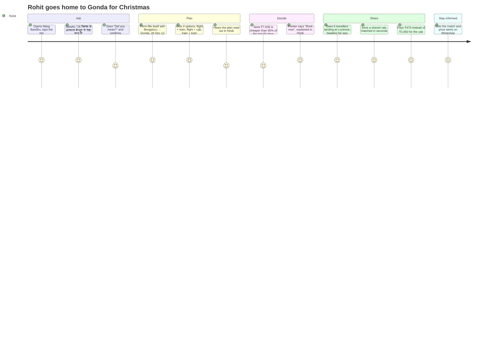
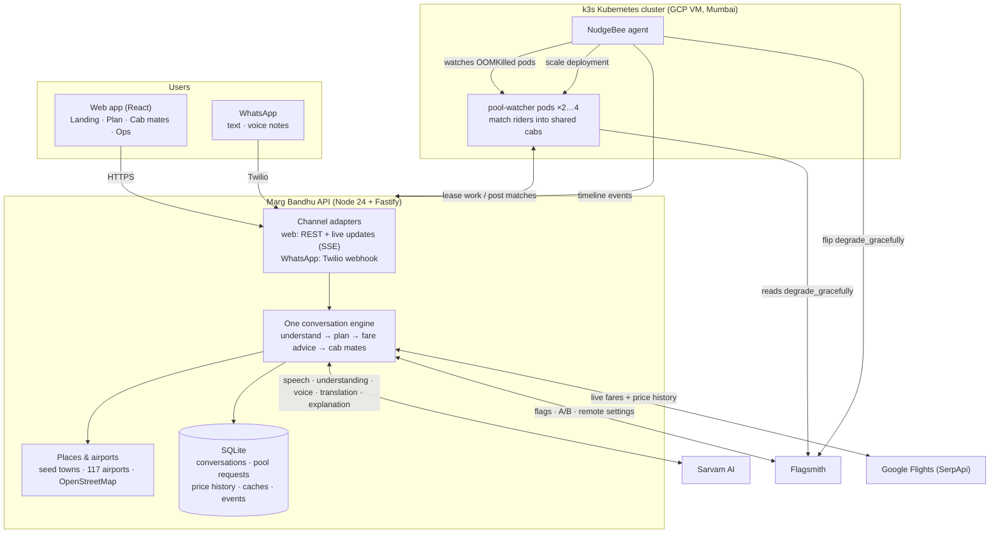

# Marg Bandhu

**Your travel companion across India: one plan, door to door, in your own language.**

Tell Marg Bandhu where you want to go, by typing or speaking in Hindi, English, Hinglish or another Indian language. It plans the whole journey (flight, train and cab), tells you whether to book your ticket now or wait, and finds people landing at the same airport so you can share the last stretch home.

Built in one day at **Festive Hacks 2026** (WeMakeDevs × WeAreDevelopers, Bengaluru) with all three sponsor tools: **Sarvam AI**, **Flagsmith** and **NudgeBee**.

> 🔗 **Try it:** https://34-93-164-65.sslip.io  ·  [Plan a trip](https://34-93-164-65.sslip.io/#/plan)  ·  [30-second demo](https://34-93-164-65.sslip.io/#/plan?demo=1)  ·  [Ops page](https://34-93-164-65.sslip.io/#/ops)
>
> 📱 **On WhatsApp:** send the join code shown on the website to **+1 415 523 8886**, then write or say your trip, for example *"Bengaluru se Gonda 26 Dec"*.

---

## Contents

1. [Our vision](#our-vision)
2. [What Marg Bandhu does](#what-marg-bandhu-does)
3. [How to use it](#how-to-use-it)
4. [How we used the three sponsor tools](#how-we-used-the-three-sponsor-tools)
5. [What is real and what is simulated](#what-is-real-and-what-is-simulated)
6. [The user journey](#the-user-journey)
7. [Technical architecture](#technical-architecture)

---

## Our vision

Millions of people in India travel long distances to get home: a student in Bengaluru going back to Gonda, a nurse in Mumbai visiting family in Jamshedpur, a family in Delhi heading to Shimla. Most of these trips are not a single ticket. They are a flight to the nearest big airport, then a train or a long cab ride, and sometimes a bus.

Today that means:

- **three or four different apps**, none of which talks to the others;
- **English-only screens**, for travellers who are more at ease in Hindi, Bhojpuri, Tamil or Bengali;
- **fares that change every day**, and no honest answer to "should I book now or wait?";
- **a ₹2,000+ cab** for the last 150 km, taken alone, while other people from the same flight are heading the same way.

The problem gets worst in the **festive rush**, from Diwali to New Year, when everyone travels at once.

**Our vision:** one trusted companion that plans the whole journey from your door to your destination, speaks your language, is honest about prices, and connects you with fellow travellers. It should keep working on the busiest night of the year. *Marg Bandhu* means "friend of the road".

---

## What Marg Bandhu does

| | What you get | In plain words |
|---|---|---|
| 🗣️ | **Speak or type in your language** | Say *"26 दिसंबर के आसपास बेंगलुरु से गोंडा जाना है"* or type it. Marg Bandhu understands **22 Indian languages plus English**, including mixed Hindi-English, and fills in the form for you. Replies come back in your language, and can be spoken aloud in 11 languages. |
| 🗺️ | **Any place in India** | Big cities, small towns, villages. If your town has no airport, Marg Bandhu finds the nearest good one, and a backup airport if the nearest has no flights that day. |
| 🧭 | **A door-to-door plan** | It combines flights, trains and cabs into complete journeys: for example, fly Bengaluru → Lucknow, then take the Saryu Intercity to Gonda. Each option shows its timings, total price and travel time, labelled **Recommended**, **Fastest** or **Cheapest**. It also checks a day or two either side of your date if you're flexible. |
| 🚕 | **"Cab all the way"** | For shorter trips (up to about 700 km, like Delhi → Shimla), it also shows a direct cab door to door. |
| 📈 | **"Should you book today?"** | It shows today's real lowest flight price (from Google Flights) next to the last ~60 days of prices for that route and date. It tells you how today compares ("cheaper than 65% of days") and how often the price has dropped from this level before. Then it gives a clear pointer, **Book now** or **Let us watch it**, explained in one or two sentences in your language. It never makes up a future price. |
| 🔔 | **Price watch** | Ask it to watch a fare, and you get a notification on the website and on WhatsApp when the price drops. |
| 👥 | **Find cab mates** | A map shows other travellers landing at the same airport around the same time and heading your way. Join a shared cab with one tap. |
| ⚖️ | **A fair fare split** | In a shared cab, each stretch of road is split between the people still in the car. Whoever gets off first pays least, and everyone sees exactly what they pay and save. |
| 💬 | **Works on WhatsApp too** | Send a text or a voice note. You get the same plan as a detailed message plus a voice reply. Reply **POOL** to find cab mates, **WATCH** for price alerts, or **NEW** to start a new trip. |
| 🎉 | **Built for the festive rush** | During festival season Marg Bandhu leaves bigger gaps between connections, because crowds slow everything down. And when traffic spikes on the busiest night, the system heals itself (see [NudgeBee](#nudgebee-keeping-it-running-on-the-busiest-night)). |
| 🔍 | **"Behind the scenes" panel** | For the curious, a live list of every step the app took for your trip: what Sarvam understood, which Flagsmith settings applied, which flights were found. |

---

## How to use it

### On the website

1. **Open** https://34-93-164-65.sslip.io and press **Plan a trip with us**.
2. **Describe your trip** in the dark bar at the top, in any way you like:
   - type it: *"Delhi to Shimla 28 Dec"*, *"Mumbai se Jamshedpur 2 January"*;
   - or press the **🎤 microphone**, speak, and press it again to stop. Marg Bandhu shows **"Did you mean?"** with what it heard. Fix anything that's wrong, then press **Yes, plan it**.
3. **Check the form.** From, To, date, how flexible you are (exact date, or ±1–3 days) and the travel modes you're happy with (✈️ flight, 🚆 train, 🚕 cab) are filled in for you. You can also fill or change them by hand. Start typing a place in **From** or **To** and suggestions appear.
4. Press **Generate a trip plan for me**. In a few seconds you see:
   - **Ways to get there:** the best options, each with every leg, timing and price;
   - **Find cab mates:** how many travellers are heading your way from the arrival airport, and your likely share of the cab;
   - **Should you book today?:** today's price, the price history chart, and the pointer.
5. **Next steps:**
   - Press **🔔 Monitor & notify me when it drops** to watch the fare.
   - Press **Find cab mates for me** to open the map, then **Pool with them**. You're told the moment a group forms, with what each person pays.
   - Add your phone number under **Also send alerts to WhatsApp** to get the same alerts on your phone.
6. Press **New trip** (top right) to start again.

> **Tip:** the **30-second demo** button on the home page fills in and plans a sample Hindi trip (Bengaluru → Gonda) automatically.

### On WhatsApp

1. Save **+1 415 523 8886** and send it the **join code** shown on the website (a one-time step for the test WhatsApp number we use).
2. Send your trip as a **text** (*"Bengaluru se Gonda 26 Dec, flight aur cab"*) or a **voice note** in your language.
3. For a voice note, Marg Bandhu first tells you what it heard (*"🎙️ I heard: …"*), so you can correct it.
4. You get the plan in two messages (the route, then the price advice and cab mates) and a voice reply. Then reply with:
   - **POOL** to find cab mates and share a cab,
   - **WATCH** to get a message when the fare drops,
   - **NEW** to plan a new trip.

### Good to know

- **Languages:** Marg Bandhu *understands* 22 Indian languages and English (typed or spoken). It *writes* its replies in Hindi and English by hand, and in 9 more languages through translation (Bengali, Tamil, Telugu, Kannada, Malayalam, Marathi, Gujarati, Punjabi, Odia). It can *speak* in all 11.
- **Places:** anywhere in India. Places abroad (Nepal, Dubai…) get a polite "we plan trips within India for now". If a place can't be found on the map, it asks for the nearest town.
- **Booking:** Marg Bandhu plans and advises. The **Book now** button is a placeholder for handing over to an airline or travel site.

---

## How we used the three sponsor tools

### Sarvam AI: understanding and speaking the user's language

Sarvam is how Marg Bandhu listens, understands and talks back. We use five of its models, each for one job:

| Sarvam model | What it does in Marg Bandhu | Where you see it |
|---|---|---|
| **Saaras v4** (speech to text) | Turns a spoken trip, from the website mic or a WhatsApp voice note, into text. It works out the language by itself and copes with Hindi-English mixing. The app converts the recording to a clean 16 kHz audio file first. | The "Did you mean?" step on the web; "🎙️ I heard…" on WhatsApp |
| **Sarvam-105B** (language model) | Reads the sentence and pulls out the trip as structured data: from, to, date, flexibility, travel modes, number of travellers. Place names come back exactly as the user said them ("शिमला" → "Shimla"), so any Indian place works. | The form filling itself in |
| **Sarvam-105B conversations** | Writes the two-sentence explanation of the fare pointer in the user's language, for example *"अभी बुक करें क्योंकि ₹7,935 सामान्य किराये ₹9,286 से कम है…"* | "Should you book today?" card and WhatsApp |
| **Bulbul v3** (text to speech) | Speaks the plan back in the user's language. | The audio player on the plan; the WhatsApp voice reply |
| **Mayura** (translation) | Translates replies into languages beyond Hindi and English. | Replies in Tamil, Bengali, Marathi… |

**How we keep the AI honest.** A travel app must never invent a train or a price, so the AI's job is narrow:

- **The AI only understands. It never decides.** Sarvam-105B turns words into a trip request. Routes, timings and prices come from our planner and real data, and the reply text is written from templates filled with those facts.
- **Guards against guessing.** If the model names a different city from the one the user said (for example "Nepal" becoming "Delhi"), the app ignores it. Past dates and travel modes the user never mentioned are dropped too.
- **The fare explanation is checked.** Sarvam gets ready-made phrases built from the price history and may only join them into natural sentences. If its text contains any number that isn't in those phrases, or a guess about future prices ("fares may rise"), it is thrown away and a hand-written explanation is used instead. If Sarvam is slow (over ~4.5 s), the hand-written version is shown and Sarvam's text is saved for next time.
- **Never stuck.** If Sarvam can't be reached, a built-in parser still understands common Hindi and English trip sentences.

### Flagsmith: the control panel for the whole platform

Flagsmith lets us change how Marg Bandhu behaves **while it is running, without releasing new code**. Every decision the app makes reads these flags. Each user gets their own evaluation, based on their channel (web or WhatsApp), their destination airport and their language. If Flagsmith is unreachable, every flag has a safe default.

| Flag | Kind | What it controls |
|---|---|---|
| `festive_rush_mode` | switch | **Festival season on/off.** On, train and flight connections get a 120-minute safety gap instead of 75, and the cab-mate search window gets 50% wider. Turn it off and re-plan: the gaps shrink immediately. |
| `pooling_enabled` | switch + segments | **Shared cabs on/off.** It can be rolled out city by city, using a Flagsmith *segment* on the user's destination airport. |
| `book_nudge_copy` | A/B test | **Which wording works better?** Half the users see an "urgent" tone ("Book now") and half a "savings" tone ("Lock in ₹X today"). Every press of **Book** is recorded against the variant the user saw, so we can compare. |
| `fare_model`, `split_weights`, `watcher_config` | remote settings | Settings we can tune live: the simulated fare model, how cab mates are matched and the fare split (group size, time window, route angle, detour per stop), and how much work each background worker takes at once. |
| `live_fares_enabled` | kill switch | Turns live Google Flights prices on or off, to protect the monthly search allowance. |
| `fare_explainer_enabled` | switch | Lets Sarvam write the fare explanation, or uses only the hand-written text. |
| `voice_input_enabled`, `whatsapp_channel_enabled` | kill switches | Switch off the microphone, or the whole WhatsApp channel, instantly if something goes wrong. |
| `judge_controls` | switch | Shows the demo buttons: simulate a surge, a new traveller, a price drop. |
| `degrade_gracefully` | emergency switch | **Flipped automatically by NudgeBee during an incident.** The background workers take 10× smaller batches at half the speed, so they stop crashing and alerts keep flowing. |

`scripts/flagsmith-setup.mjs` creates all of these flags in a Flagsmith project in one go. If a flag doesn't exist in Flagsmith yet, the app uses its own default rather than treating it as "off".

### NudgeBee: keeping it running on the busiest night

Matching people into shared cabs is done by **background workers** ("pool watchers"). These run as separate containers on our Kubernetes cluster, so we can add more when it gets busy. On the night before a big festival, requests spike. Each worker then tries to process a large batch at once, runs out of its memory allowance, and gets shut down by Kubernetes (an **OOMKilled** crash). Users stop receiving "someone joined your cab" alerts, exactly when they need them most.

**NudgeBee watches the cluster and fixes this:**

1. **Detect.** The NudgeBee agent, installed on our cluster, sees the watcher containers crashing with OOMKilled.
2. **Diagnose.** NudgeBee's AI root-cause analysis explains why: the memory limit is exceeded while matching a large batch.
3. **Ask a human.** It waits for approval: *"Scale pool-watcher to 4 and enable degrade_gracefully?"*
4. **Fix.** After approval it scales the watchers up to 4, and calls the **Flagsmith API** to turn on `degrade_gracefully`. Within seconds every worker switches to small batches, and memory drops from about 600 MB to 70–160 MB per worker.
5. **Report.** It posts each step to the app's **Ops page** timeline (and optionally to a Discord channel), so everyone can see what happened and when.

On the **Ops page** you can rehearse this yourself: press **Simulate Diwali-eve surge** to add 1,500 cab requests at once. You then watch the workers turn red ("gone: OOMKilled"), NudgeBee's steps appear on the timeline, the flag flip to ON, and the queue drain. We verified this crash → degrade → recovery cycle on the live cluster. The workflow recipe is in [`k8s/nudgebee-workflow.md`](k8s/nudgebee-workflow.md).

**The three tools together:** *Sarvam* makes the app usable by everyone, *Flagsmith* lets us steer it live, and *NudgeBee* keeps it standing when everyone shows up at once. During an incident NudgeBee works *through* Flagsmith to change the app's behaviour without a redeploy.

### Other services we rely on

| Service | Used for |
|---|---|
| **Google Flights** (via SerpApi) | Live flight prices, Google's "low / typical / high" rating, its typical price range and about 60 days of price history. Each search is cached for 6 hours, and the app keeps its own growing price history. |
| **OpenStreetMap** (Nominatim) | Finding any town or village in India on the map, including its Hindi name. Each place is looked up once and saved. |
| **OurAirports** | The list of 117 Indian airports with scheduled flights, used to find each place's nearest good airport. |
| **Twilio WhatsApp** | The WhatsApp channel: messages in and out, voice notes, alerts. |

---

## What is real and what is simulated

We want to be upfront about this.

| Live and real | Simulated for the demo |
|---|---|
| Understanding speech and text, the spoken replies and translation (Sarvam) | Train timetables and train fares. There is no public IRCTC API; we seeded realistic routes such as Udyan Express, Deccan Queen, Saryu Intercity and Gitanjali Express |
| Flight prices and price history for the requested date (Google Flights) | Flights on the flexible ± days, scaled to the live price |
| Places and airports anywhere in India (OpenStreetMap, OurAirports) | The other travellers on the cab-mates map |
| All Flagsmith flags, A/B test and remote settings | The 30-second re-checks of a watched fare (to save the search allowance) |
| WhatsApp messages and voice notes (Twilio) | Cab fares (₹300 + ₹14/km, a typical outstation rate) |
| The Kubernetes surge → OOMKilled → NudgeBee recovery | |

**Other limits today:**
- Train timetables only exist on the seeded routes: UP and Bihar towns, Bengaluru ⇄ Mumbai ⇄ Pune, Hyderabad ⇄ Jhansi, Jamshedpur ⇄ Mumbai. Elsewhere the plan says *"Check IRCTC for trains"*.
- The test WhatsApp number needs each phone to send the join code first.
- Booking is not connected.

**About the price pointer:** we replayed its rules on real price histories to see how often they would have been right. They beat "always book now" on routes where prices really do drop (58% vs 39% on Bengaluru → Lucknow). On routes with flat prices they don't, so the app checks each route's own history and only says "watch it" where waiting has actually paid off. You can rerun this check with `node scripts/backtest-fares.mts`.

---

## The user journey

Meet **Rohit**, who works in Bengaluru and wants to be home in Gonda (Uttar Pradesh) for Christmas. Gonda has no airport. He is more comfortable in Hindi.



**Step by step:**

1. **Ask.** Rohit opens Marg Bandhu on his phone, taps the mic and says his trip in Hindi. **Sarvam Saaras** turns it into text and shows *"Did you mean?"*. He confirms.
2. **Understand.** **Sarvam-105B** extracts: from Bengaluru, to Gonda, around 26 December, flexible by two days, any mode. **Flagsmith** is consulted for Rohit's settings: festive rush mode is on, pooling is enabled for Lucknow, and he is in the "urgent" copy group.
3. **Plan.** The planner sees that Gonda has no airport. Its nearest good airport is Lucknow, 125 km away. It gets the **live Google Flights** results for Bengaluru → Lucknow on the 26th, then finds the trains and cabs that connect, keeping a 120-minute buffer because of the festive rush. The top 4 options are tagged *Recommended*, *Fastest* and *Cheapest*. **Sarvam Bulbul** reads the headline back in Hindi.
4. **Decide.** The fare card shows that today's ₹7,935 is below the usual price for this route (median ₹9,286) and cheaper than 65% of the last 60 days. Nothing in the history suggests waiting will pay, so the pointer says **Book now**, and **Sarvam** explains why in one Hindi sentence.
5. **Share.** Five other travellers land at Lucknow around the same time and are heading towards Gonda, Basti, Ayodhya and Gorakhpur. Rohit taps **Pool with them**. A **background worker** matches a group of four in seconds. The fair split shows that Rohit, getting off first, pays ₹470 instead of ₹2,050 for a cab on his own.
6. **Stay informed.** The match arrives as a notification on the website and on **WhatsApp**, with each person's share. If Rohit had chosen to watch the fare instead, he'd get a message the moment it dropped.
7. **Behind the scenes, on Christmas eve.** Thousands of people ask for cabs at once, and the matching workers start crashing. **NudgeBee** spots it, diagnoses it, asks the on-call person, scales up, and flips **Flagsmith**'s `degrade_gracefully`. Rohit never notices. His alerts keep coming.

---

## Technical architecture

### The big picture



### How a request flows

1. **Channel adapters** take a web request or a WhatsApp message and turn voice into text (Sarvam Saaras). On WhatsApp, Twilio gets an immediate acknowledgement and the reply is sent separately, so slow AI calls never time out.
2. **The conversation engine** (one code path for web and WhatsApp):
   - **understands** the request (`intent.ts`): Sarvam-105B plus guards, with a built-in parser as fallback;
   - **resolves places** (`places.ts`): seed towns, then airports, then an OpenStreetMap lookup. Each place gets its nearest airport and a backup;
   - **plans** (`planner.ts`): flight + train / cab combinations, cab-only for short trips, and direct trains, across the flexible dates. Options are scored by price plus ₹250 per hour of travel, with penalties for arriving late at night or off the requested date;
   - **advises on fares** (`fares.ts`, `fareStats.ts`, `fareExplain.ts`): analyses the real price history, applies plain rules with a per-route self-check, and gets Sarvam's checked explanation;
   - **previews cab mates** (`pools.ts`, `pooling.ts`): riders are compatible if they land at the same airport within the time window and head in a similar direction. Fares are split stretch by stretch.
3. **Pool watchers** are separate, stateless worker pods. They lease waiting cab requests from the API, match groups, and post the results back. The API then notifies everyone on the web (live updates) and WhatsApp. Workers get the place details they need with each batch, so they need no database, and you can run as many as you like.
4. **Every step is recorded** as an event, which powers the *Behind the scenes* panel and the Ops timeline.

### Building blocks

| Layer | Technology |
|---|---|
| Web app | Vite, React 19, Tailwind CSS v4, Leaflet maps (OpenStreetMap tiles) |
| API | Node.js 24 + Fastify. TypeScript runs natively, with no build step. One Docker image with two entry points: `server.ts` (API + web app) and `watcher.ts` |
| Data | SQLite (built into Node), stored on a persistent volume |
| AI and voice | Sarvam AI: Saaras v4, Sarvam-105B, Sarvam-105B conversations, Bulbul v3, Mayura |
| Feature control | Flagsmith (server-side SDK; identities with traits; admin API for automation) |
| Live data | Google Flights via SerpApi, OpenStreetMap Nominatim, OurAirports |
| Messaging | Twilio WhatsApp sandbox |
| Hosting | One GCP VM (2 vCPU, 4 GB, Mumbai) running **k3s** Kubernetes, Traefik with Let's Encrypt HTTPS |
| Operations | NudgeBee agent (Helm), Prometheus-style `/metrics`, the Ops page |

**Built to never dead-end:** every outside service has a fallback.

| If this is unavailable… | …the app does this |
|---|---|
| Sarvam | Uses the built-in parser and hand-written replies |
| Flagsmith | Uses its own default settings |
| Google Flights | Uses simulated fares, clearly labelled |
| OpenStreetMap | Asks the user to try again |
| WhatsApp | Logs the message instead of sending it |

### For developers

**Run it on your computer (no keys needed):**

```bash
git clone https://github.com/suryafk/festivehacks.git && cd festivehacks
cd web && npm install && npm run build && cd ..
cd server && npm install
INLINE_WATCHER=1 npm run dev          # then open http://localhost:8080
```

Without keys it runs offline: the built-in parser instead of Sarvam, default flags, simulated fares, and WhatsApp messages logged instead of sent. To switch integrations on, copy `.env.example` to `.env` and add the keys you have:

| Variable | Where to get it |
|---|---|
| `SARVAM_API_KEY` | dashboard.sarvam.ai → API keys |
| `FLAGSMITH_ENVIRONMENT_KEY` | Flagsmith → Environment settings → server-side key (`ser.…`) |
| `FLAGSMITH_ADMIN_API_KEY`, `FLAGSMITH_PROJECT_ID` | Only needed for `node --env-file=.env scripts/flagsmith-setup.mjs`, which creates all flags |
| `SERPAPI_KEY` | serpapi.com (free plan: 250 searches a month) |
| `TWILIO_ACCOUNT_SID`, `TWILIO_AUTH_TOKEN`, `TWILIO_SANDBOX_JOIN` | Twilio console → WhatsApp sandbox |
| `PUBLIC_BASE_URL`, `INTERNAL_TOKEN`, `OPS_TOKEN` | Your public HTTPS address; any random strings |

**Useful commands:**

- `cd server && npm test` runs the tests: parsing, places, fare analysis, explanation checks.
- `node scripts/backtest-fares.mts` replays the fare rules on the stored price histories.
- `node scripts/build-airports.mjs <airports.csv>` rebuilds the airport list from OurAirports.

**Deploy to a cloud VM with k3s:**

1. Create an Ubuntu VM (2 vCPU / 4 GB) with ports 80 and 443 open.
2. Run `curl -fsSL https://raw.githubusercontent.com/suryafk/festivehacks/main/scripts/vm-bootstrap.sh | bash`. It installs Docker, k3s and Helm, and clones the repo.
3. In `~/festivehacks`, create `.env`, then run `./scripts/deploy.sh`. This builds the image, sets up HTTPS at `https://<ip-with-dashes>.sslip.io`, and rolls out the API and the watchers.
4. In the Twilio sandbox settings, point *When a message comes in* to `https://<host>/webhooks/whatsapp`.
5. Install the NudgeBee agent with the Helm command from your NudgeBee dashboard (with write permissions enabled), then build the workflow in [`k8s/nudgebee-workflow.md`](k8s/nudgebee-workflow.md).

**Repository layout:**

```
server/   API, conversation engine, places, planner, fare analysis, pool watcher (TypeScript on Node 24)
web/      React app: Landing, Plan, Cab mates, Ops
k8s/      Kubernetes manifests, HTTPS config, NudgeBee workflow recipe
scripts/  VM setup, deploy, Flagsmith setup, airport list builder, fare backtest
```

More detail for developers: [`CONTEXT.md`](CONTEXT.md) (full technical brief) and [`VERSION_HISTORY.md`](VERSION_HISTORY.md) (every change, with how it was tested).

---

Made at **Festive Hacks 2026**, Bengaluru, with Sarvam AI, Flagsmith and NudgeBee.
